# Network Intrusion Detection - Results Report
_Generated automatically by train.py on 2026-11-26 13:30_

## 1. Dataset
- Records loaded: **82,332**; input features: **39** (36 numeric, 3 categorical)
- Target: `label` (0 = Normal, 1 = Attack); `attack_cat` is used only for analysis.

| label | records | percent |
|---|---|---|
| Malicious Traffic | 45332 | 55.0600 |
| Normal Traffic | 37000 | 44.9400 |

| attack_cat | records | percent |
|---|---|---|
| Normal | 37000 | 44.9400 |
| Generic | 18871 | 22.9200 |
| Exploits | 11132 | 13.5200 |
| Fuzzers | 6062 | 7.3600 |
| DoS | 4089 | 4.9700 |
| Reconnaissance | 3496 | 4.2500 |
| Analysis | 677 | 0.8200 |
| Backdoor | 583 | 0.7100 |
| Shellcode | 378 | 0.4600 |
| Worms | 44 | 0.0500 |

## 2. Exploratory data analysis
- Duplicate records: **26,387** (32.05%) - removed (see step 3).
- Missing values: none - handled by imputers inside the pipeline.
- Normal vs attack (majority/minority) ratio: **1.23 : 1**.
- Attack families: largest `Generic` = 18,871 records, smallest `Worms` = 44 records (**429 : 1**) - strongly imbalanced, so recall of the rare families is checked separately in the final evaluation.

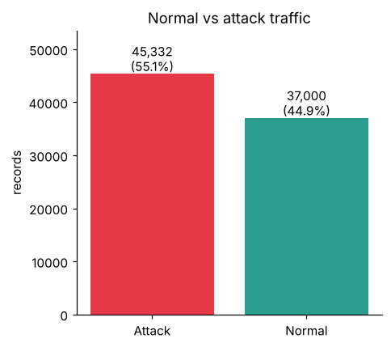
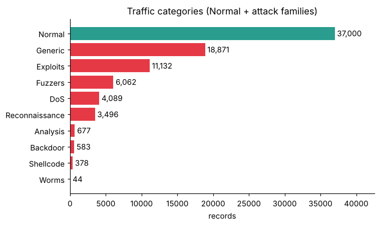
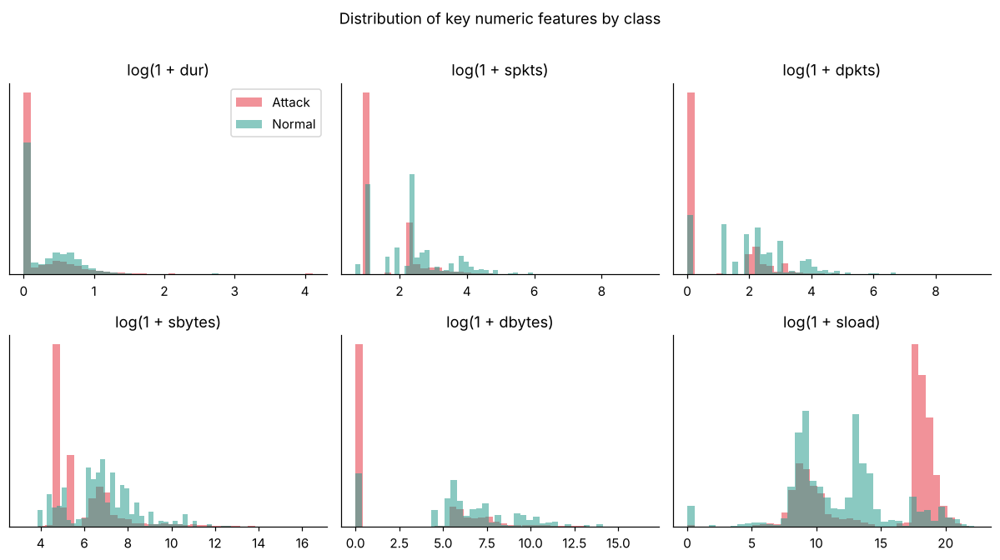
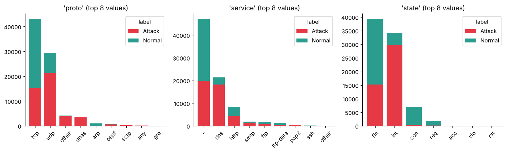
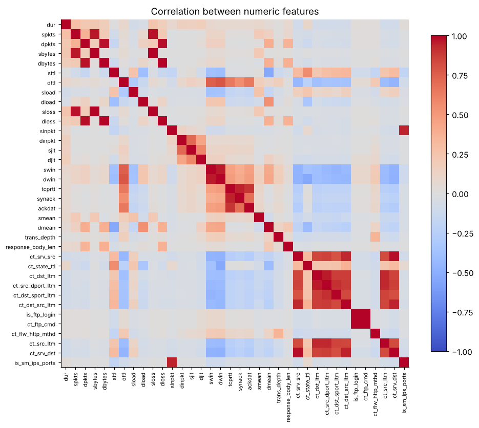

## 3. Data preparation
- Removed 26,387 duplicates; final size **55,945** records.
- Features `X` exclude `id`, `attack_cat`, `label`, addresses/ports/timestamps and TCP sequence numbers (identifiers / target-derived columns -> leakage).
- Numeric: median imputation -> signed log1p -> StandardScaler. Categorical (`proto`, `service`, `state`): most-frequent imputation -> one-hot encoding.

## 4. Train / validation / test split
- 80% train / 20% test (stratified on the label). The training part is divided again into fit (75%) and validation (25%) sets. Models are compared and tuned with train/validation data only; the test set is evaluated **once** at the end.

| index | records | attack_share |
|---|---|---|
| train-fit (60%) | 33567 | 0.3886 |
| validation (20%) | 11189 | 0.3886 |
| test (20%, untouched) | 11189 | 0.3886 |

## 5-6. Three models (default settings) - validation set
Attack = positive class. **Recall** and **FN** (attacks that slipped through) matter most.

| index | accuracy | precision | recall | f1 | roc_auc | TN | FP | FN | TP | false_negative_rate |
|---|---|---|---|---|---|---|---|---|---|---|
| Logistic Regression | 0.9249 | 0.9017 | 0.9055 | 0.9036 | 0.9739 | 6412 | 429 | 411 | 3937 | 0.0945 |
| Decision Tree | 0.9444 | 0.9223 | 0.9358 | 0.9290 | 0.9428 | 6498 | 343 | 279 | 4069 | 0.0642 |
| Random Forest | 0.9663 | 0.9621 | 0.9508 | 0.9564 | 0.9939 | 6678 | 163 | 214 | 4134 | 0.0492 |

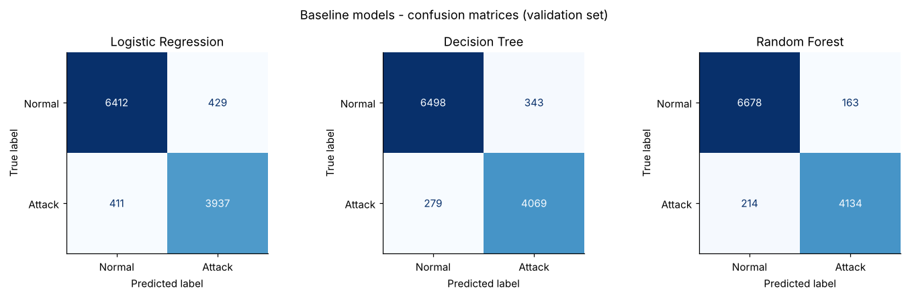

## 7. 5-fold cross-validation (default models)
Run on a stratified training subset of 30,000 rows.

F1-score of each fold:

| fold | Decision Tree | Logistic Regression | Random Forest |
|---|---|---|---|
| 1 | 0.9260 | 0.9045 | 0.9514 |
| 2 | 0.9256 | 0.8960 | 0.9472 |
| 3 | 0.9360 | 0.9052 | 0.9523 |
| 4 | 0.9314 | 0.9063 | 0.9496 |
| 5 | 0.9235 | 0.9029 | 0.9503 |
| mean | 0.9285 | 0.9030 | 0.9502 |

Mean scores:

| index | accuracy_mean | precision_mean | recall_mean | f1_mean | f1_std |
|---|---|---|---|---|---|
| Logistic Regression | 0.9249 | 0.9065 | 0.8995 | 0.9030 | 0.0037 |
| Decision Tree | 0.9444 | 0.9279 | 0.9291 | 0.9285 | 0.0046 |
| Random Forest | 0.9618 | 0.9627 | 0.9380 | 0.9502 | 0.0018 |

## 8. Hyper-parameter tuning (GridSearchCV, 5-fold, scoring = F1 of the attack class)
| index | best_params | cv_f1 | cv_recall | cv_precision | cv_accuracy | combinations |
|---|---|---|---|---|---|---|
| Logistic Regression | {"clf__C": 100, "clf__class_weight": null} | 0.9068 | 0.9013 | 0.9124 | 0.9280 | 10 |
| Decision Tree | {"clf__criterion": "entropy", "clf__max_depth": 16, "clf__min_samples_leaf": 1} | 0.9366 | 0.9250 | 0.9484 | 0.9513 | 16 |
| Random Forest | {"clf__max_depth": null, "clf__min_samples_leaf": 1, "clf__n_estimators": 200} | 0.9509 | 0.9394 | 0.9627 | 0.9623 | 12 |

## 9. Tuned models and model selection (validation set)
| index | accuracy | precision | recall | f1 | roc_auc | FN | false_negative_rate | cv_f1 |
|---|---|---|---|---|---|---|---|---|
| Logistic Regression | 0.9272 | 0.9077 | 0.9046 | 0.9061 | 0.9762 | 415 | 0.0954 | 0.9068 |
| Decision Tree | 0.9543 | 0.9507 | 0.9308 | 0.9406 | 0.9648 | 301 | 0.0692 | 0.9366 |
| Random Forest | 0.9664 | 0.9632 | 0.9499 | 0.9565 | 0.9941 | 218 | 0.0501 | 0.9509 |

**Selected model: Random Forest** - rule: highest validation F1-score of the attack class (recall as tie-breaker).

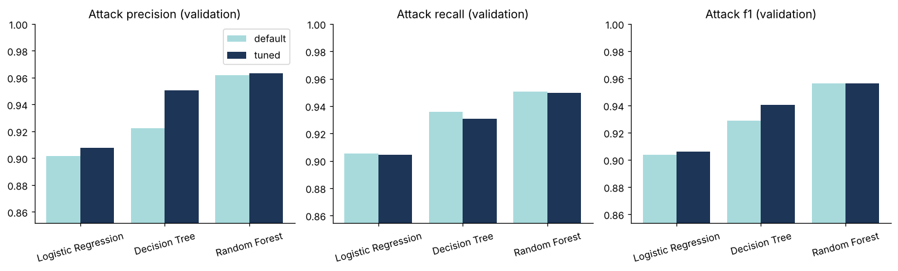

## 10. Final evaluation of the selected model on the untouched test set
**Model:** Random Forest  
**Hyper-parameters:** `{'clf__max_depth': None, 'clf__min_samples_leaf': 1, 'clf__n_estimators': 200}`

```
              precision    recall  f1-score   support

      Normal     0.9705    0.9806    0.9755      6841
      Attack     0.9689    0.9531    0.9609      4348

    accuracy                         0.9699     11189
   macro avg     0.9697    0.9668    0.9682     11189
weighted avg     0.9699    0.9699    0.9698     11189
```

Confusion matrix: TN = 6,708, FP = 133, FN = 204, TP = 4,144. Missed attacks (false negatives): **204** (4.69% of all attacks); false alarms: 133 (1.94% of normal traffic).

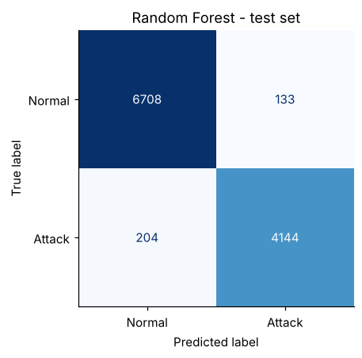 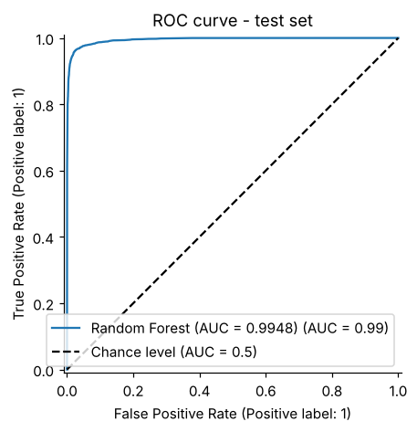

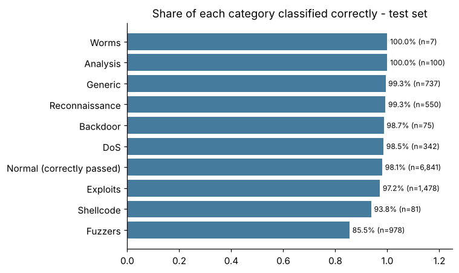

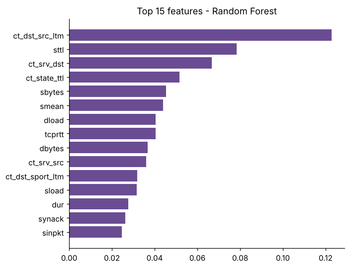

## 11. Saved artefacts
- `models/best_model.joblib` - complete pipeline (preprocessing + classifier)
- `models/tuned_*.joblib` - the three tuned models
- `models/metadata.json` - feature list, defaults, categories, test metrics
- Use `python predict.py` (CLI) or `python app.py` (web form) for new records.